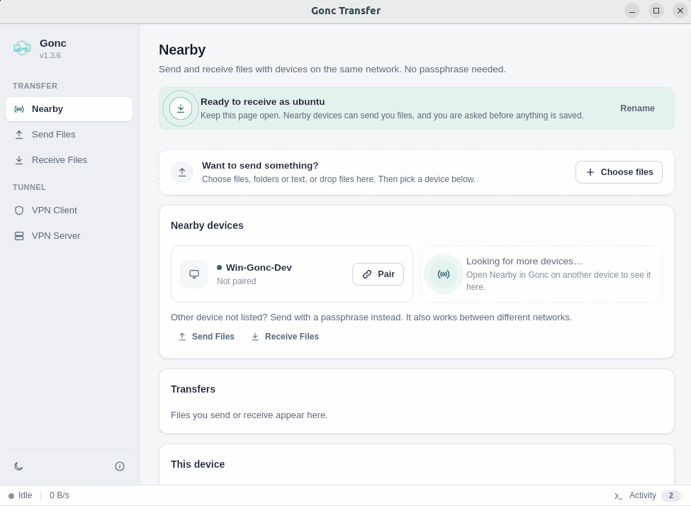
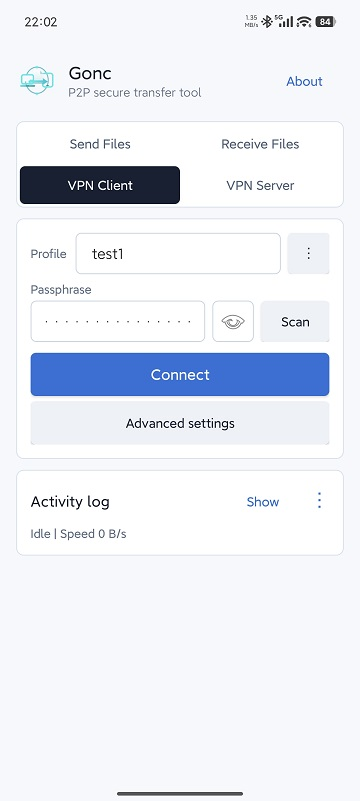
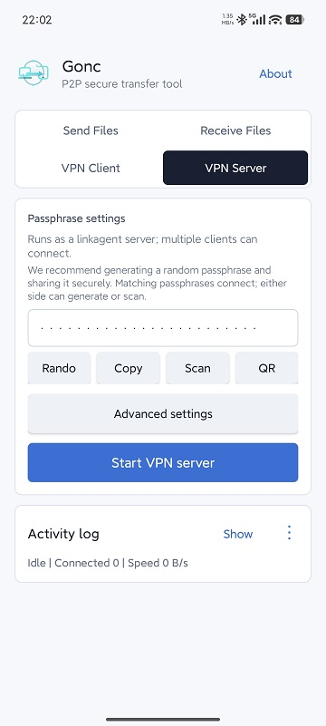

# Gonc

[中文说明](README_zh.md)

Point-to-point secure file transfer and VPN tunneling for desktop and Android.

Gonc helps two devices find each other with a shared passphrase. On the same
LAN, peers can quickly discover each other and connect directly over the local
network. Across different networks, Gonc uses NAT traversal and hole punching to
establish a peer-to-peer direct connection. No account, no cloud upload, no file
size gate. Gonc also includes a VPN mode for building an encrypted tunnel
between your own devices.



<p>
  
  
</p>

## Features

- **Send files and folders directly** - Share multiple files or whole
  directories between desktop and Android.
- **No accounts** - A shared passphrase is enough to connect both sides.
- **Nearby devices** - On the same network, pick a device and send. Pair once by
  comparing a six-digit number; later transfers only need the recipient to
  accept.
- **End-to-end encrypted** - Traffic is protected by TLS 1.3. The TLS
  certificates are automatically derived from the shared passphrase and mutual
  authentication is mandatory, so no CA certificate is required and
  man-in-the-middle eavesdropping or tampering is prevented.
- **True P2P when connected** - A successful transfer uses a real peer-to-peer
  connection. Gonc does not provide an official relay service by default.
- **Reliable receive mode** - Browse the remote file list, download everything
  or selected paths, and resume interrupted downloads with BLAKE3 block repair.
- **Android and desktop UI** - The same workflow is available on Windows and
  Android.
- **Easy VPN deployment** - Run `gonc -p2p <passphrase> -linkagent` on many
  device architectures, then connect remotely from the desktop or Android VPN
  client.
- **IPv4 and IPv6 aware** - VPN mode supports IPv6 routing checks and DNS leak
  protection options on Windows.

## Download

Download the latest build from
[GitHub Releases](https://github.com/threatexpert/gonc-gui/releases).

Release packages are named like:

| Platform | Package |
| --- | --- |
| Windows x64 | `gonc-gui-<version>-windows-amd64.zip` |
| Windows arm64 | `gonc-gui-<version>-windows-arm64.zip` |
| Linux x64 | `gonc-gui-<version>-linux-amd64.tar.gz` |
| Linux arm64 | `gonc-gui-<version>-linux-arm64.tar.gz` |
| Android arm64 | `gonc-gui-<version>-android-arm64.apk` |

On Windows, keep `gonc-gui.exe` and `wintun.dll` in the same folder when using
VPN features.

## How It Works

1. The sender chooses files or folders and starts sharing.
2. Gonc generates or accepts a passphrase.
3. The receiver enters or scans the same passphrase.
4. Both sides exchange encrypted connection information over public MQTT
   signaling servers.
5. Gonc tries NAT traversal and starts the transfer after a real P2P connection
   is established.

The signaling server is only used to help both peers meet. It cannot see the
passphrase and cannot decrypt the exchanged network information.

If both peers are behind restrictive IPv4 NATs, NAT traversal may fail. In that
case, use a SOCKS5 proxy server as a relay path.

### NAT Traversal Support

If both peers have IPv6 connectivity, direct P2P connection is usually the
easiest case.

For IPv4, NAT traversal behavior depends on the NAT type on each side:

| Type | NAT type | P2P traversal difficulty |
| --- | --- | --- |
| 1 | Full Cone NAT | Easiest |
| 2 | Restricted Cone NAT | Easy |
| 3 | Port Restricted Cone NAT | Medium |
| 4 | Symmetric NAT | Hardest |

Gonc's expected IPv4 traversal support:

| Peer A NAT | Peer B NAT | Expected result |
| --- | --- | --- |
| Type 1 | Type 1, 2, 3, or 4 | Works with TCP and UDP |
| Type 2 | Type 2, 3, or 4 | Works with TCP and UDP |
| Type 3 | Type 3 or 4 | Works with UDP |
| Type 4 | Type 4 | Does not work directly; connect through a user-provided SOCKS5 proxy server that supports UDP ASSOCIATE |

## Nearby (Same Network)

The **Nearby** page lists Gonc devices on the same local network. No
passphrase is needed.

1. Open **Nearby** on both devices. (From **Send Files** or **Receive Files**,
   use the **Send to nearby devices** link or the **Receive from Nearby**
   button.) A device can be found only while its Nearby page is open; the
   banner at the top shows the name others see it as.
2. Add files, folders, text or clipboard content.
3. On the other device's card, choose how to send:
   - **Pair & send** shows the same six-digit number on both devices. Confirm
     on both if they match. The devices stay paired, and later transfers to a
     paired device skip this step.
   - **Send** (unpaired devices only) sends without comparing numbers. Use it
     for files that are fine for anyone on the network to see: nothing proves
     who the other device is, and the devices do not become paired.
4. The recipient sees the sender's name and the file list and clicks
   **Accept**. A request from an unpaired device is marked **Not paired**.
   Files are saved to the folder shown under **This device**; an existing file
   is never overwritten (a copy is saved as `name (1).ext`). To receive only
   from paired devices, turn off **Accept files from unpaired devices** under
   **This device**.

Nearby transfers go directly between the two devices over TLS 1.3 and never
contact the MQTT or STUN servers, so they also work on a network with no
internet access. Devices find each other with multicast on UDP port 19731 and
accept connections on TCP port 19732. Gonc sends discovery traffic only while
the Nearby page is open; on other pages it stays quiet on the network, and
transfers already running carry on. A device whose firewall blocks incoming
connections still works: every announcement asks nearby devices to reply, and
when a direct connection is not answered, both devices meet the way
passphrase LAN mode does, by multicasting to each other and dialing each other
at the same time. The **Activity** log (bottom right) shows which path was
used. Where the other device is not listed (some guest or office Wi-Fi
blocks multicast, or the devices are on different networks), use
**Send Files** and **Receive Files** with a passphrase instead.

Advertisements carry a value that changes over time instead of a fixed device
ID, so the device cannot be tracked across networks; the device name is still
visible to others on the same network. Turn off **Visible to nearby devices**
to stop advertising. Pairing keys are encrypted with Windows DPAPI; on macOS
and Linux they are currently stored in a file readable only by the current
user.

## Send Files

Desktop send-content capabilities:

| Content source | Windows desktop | macOS/Linux desktop |
| --- | --- | --- |
| File | Supported | Supported |
| Folder | Supported | Supported |
| Authored text | Supported | Supported |
| Clipboard text | Supported | Supported |
| Native clipboard files | Supported | Unsupported; the app shows an explicit unsupported message when no readable clipboard text is available |
| Native clipboard image | Supported (saved as a generated PNG) | Unsupported; the app shows an explicit unsupported message when no readable clipboard text is available |

The single **Add** button opens a four-option picker for **File**, **Folder**,
**Text**, and **Clipboard**. Files and folders can also be added by drag and
drop. Each list row has its own remove control, and **Clear all** empties the
whole list. Changes made while a send session is running are synchronized with
the receiver, including an empty list after the receiver refreshes.

1. Open **Send Files**.
2. Add the content to share.
3. Use the generated passphrase, or enter your own strong passphrase.
4. Share the passphrase or QR code with the receiver through a trusted channel.
5. Keep the sender running until the receiver finishes.

## Receive Files

1. Open **Receive Files**.
2. Enter or scan the sender passphrase.
3. Choose the save folder.
4. Connect, browse the remote directory, then download selected files or the
   current folder.

Resume mode validates local blocks with a BLAKE3 manifest before reusing them.
For interrupted downloads, Gonc resumes from the last verified complete block
instead of blindly trusting the local file size.

After a received file exists as a readable regular file and its size matches the
current remote listing, the receive list marks it as locally available. This is
a convenience check, not a content-integrity guarantee. On desktop, the row's
locate button reveals the file in Explorer, Finder, or the platform file manager;
Gonc does not open received files directly on desktop.

On Android, locally available files can be opened, opened with another app,
shared, or inspected from the current receive session. These actions are not
saved as download history across app launches. Opening an APK hands it to
Android's package installer, which controls unknown-source authorization and
installation confirmation; Gonc does not install packages silently.

## VPN Tunnel

Gonc can also run a VPN tunnel between devices. Deploying the server is meant to
be simple: on a remote device, run:

```text
gonc -p2p <passphrase> -linkagent
```

Then connect to it from the desktop or Android VPN client.

- **VPN Server** runs a `linkagent` endpoint and can expose this device as the
  traffic exit.
- **VPN Client** connects to the server and can start a system VPN interface.
- Profiles can be saved and shared by QR code.
- Advanced options include DNS servers, route CIDRs, MTU, route metric, upstream
  proxy, tunnel-only mode, and extra `gonc` arguments.

On Windows, VPN client mode may request administrator permission so it can
configure routes and DNS protection.

## Privacy And Security

- Gonc does not require user accounts.
- File data is transferred only after the TLS 1.3 secure connection is
  established. Even when a SOCKS5 server is used as a relay path, it only sees
  TLS-encrypted traffic and cannot read or tamper with file contents.
- The shared passphrase is the connection secret. Anyone who has it can connect
  and receive your shared files, so use the randomly generated high-strength
  passphrase each time and do not reuse passphrases that have already been
  shared.
- Gonc derives the TLS certificates from the passphrase and requires mutual
  authentication, so no CA certificate is required.
- Gonc uses public third-party STUN servers to discover NAT addresses and public
  MQTT servers for signaling. Peers meet on MQTT using a passphrase-derived
  hash, and network addresses are exchanged as AES-GCM encrypted data derived
  from the passphrase. MQTT servers cannot see the passphrase or decrypt the
  exchanged addresses.
- File repair uses BLAKE3 block hashes to avoid trusting stale local data.

Public servers used for STUN and signaling:

```text
STUN:
tcp://turn.cloudflare.com:80
udp://turn.cloudflare.com:53
udp://stun.l.google.com:19302
stun.gonc.cc:3478
global.turn.twilio.com:3478
stun.nextcloud.com:443

MQTT:
tcp://broker.hivemq.com:1883
tcp://broker.emqx.io:1883
tcp://test.mosquitto.org:1883
tcp://mqtt.gonc.cc:1883
```

## Troubleshooting

### Windows App Does Not Open

Gonc uses Microsoft Edge WebView2 through Wails. If the app does not open,
install or repair the
[Microsoft Edge WebView2 Runtime](https://developer.microsoft.com/microsoft-edge/webview2/).

### Android VPN Stops In The Background

Android may restrict long-running background work. Allow Gonc to ignore battery
optimization or set the app battery mode to unrestricted.

### Transfer Cannot Connect

- Make sure both sides use the exact same passphrase.
- If both sides are behind type 4 / Symmetric NAT, configure your own SOCKS5
  proxy server with UDP ASSOCIATE support so Gonc can use it as the relay path.


## Development

The desktop app is built with Wails and embeds the `gonetcat` Go engine. The
Android app uses a gomobile-generated `mobilegonc.aar` built from the sibling
`gonetcat` checkout.

### Desktop tun2socks dependency

Desktop code now calls the independent `github.com/threatexpert/gonc/v2/tunengine`
package instead of importing tun2socks directly. Android's mobilegonc wrapper
uses the same package and defaults. OS routes, DNS and Android FD ownership stay
in their existing platform adapters. The gonc CLI does not import this package.

The shared engine is pinned to published gonc commit
`ee76a9aa423e806f7cf43b63e87188b5c1da5ec2`, resolved as
`v2.6.13-0.20261116125136-ee76a9aa423e` in `go.mod` and verified by `go.sum`.
Normal builds use `GOWORK=off` and plain `wails build`; no local workspace,
sibling source checkout, `-m`, or `-nosyncgomod` is needed for desktop builds.

Desktop builds pin `github.com/threatexpert/tun2socks` commit
`4b0120a38bf2ea724209882f0d7d5352dc75a436` through a versioned `replace` in
`go.mod`; imports keep the upstream `github.com/xjasonlyu/tun2socks/v2` path.
Go 1.27.1 or newer is required. The local build scripts and GitHub desktop
release workflow set `GOWORK=off`, so neither a sibling checkout nor a local
workspace file is needed. No `gonc_deferred_tcp` tag is required. The top-level
tun2socks `replace` remains necessary because Go does not inherit replacements
from dependency modules.

Every desktop build enables deferred TCP handshakes, a 30-second / 4096-entry
failed-SYN cache, and a 30-second SOCKS5 handshake timeout after the fixed
5-second proxy connection timeout. Local IPv6 TCP/UDP rejection is enabled
only when IPv6 routes are configured and the exit probe fails; reconnecting
re-evaluates the probe result. These are application settings, not changes to
the fork's default behavior.

Android is separate: its checked-in `mobilegonc.aar` is not rebuilt by the
desktop Go build or the GitHub APK job. The Android client calls
`StartTun2SocksWithPolicy` in the updated gonc mobile wrapper to enable the same
deferred-TCP settings and probe-dependent IPv6 rejection. A new tunnel-ready
generation triggers another probe and an engine restart even when DNS is
unchanged; in that case the existing VPN interface is retained. The original
`StartTun2Socks` API remains available with both features disabled for older
callers. Rebuild the AAR from the updated gonc checkout before building the APK;
changing this repository's `go.mod` alone does not update the native engine.

The project, local CLI and GitHub workflow use Wails v2.17.1. For a manual
desktop build, set `GOWORK=off` and use `wails build` with the desired platform
(and `webkit2_41` tag on Linux). No embed-scanner bypass or placeholder script
is needed. Wails generates bindings, frontend assets, app icons and platform
manifests normally, including on a fresh checkout. Prefer the supplied build
scripts.


Rebuild the Android Go bridge after changing `..\gonetcat`:

```text
android\update-mobilegonc-aar.bat
```

### Build on Windows

Prerequisites (the same tools the GitHub release workflow uses):

- Go, at the version in `go.mod`
- Node.js with npm (the release workflow uses Node.js 24)
- Wails CLI v2.17.1
- Microsoft Edge WebView2 Runtime, to run the app

Install the Wails CLI, and make sure `GOBIN` (by default `GOPATH\bin`) is on
`PATH`:

```text
go install github.com/wailsapp/wails/v2/cmd/wails@v2.17.1
```

From the project root, build:

```text
.\build.bat
```

The script sets `GOPROXY=https://goproxy.cn,direct`, installs the frontend
dependencies, runs `wails build -platform windows/amd64`, and copies the
required Wintun DLL. Pass `arm64` to build for Windows arm64. Outputs:

```text
build\bin\gonc-gui.exe
build\bin\wintun.dll
```

Keep `wintun.dll` next to `gonc-gui.exe` when you distribute it.

Plain `go build` is not equivalent to this build. It does not run the Wails
frontend build or generate the Windows resources. During `wails build`, Wails
writes a temporary `gonc-gui-res.syso` with the app icon and Windows manifest,
links it in, and deletes it afterwards, so finding no `.syso` in the repository
is normal, and separate `rsrc` or `windres` tools are not needed. A plain
`go build` (which also needs the `desktop,production` tags and an
already-built `frontend\dist`) produces an exe without the icon and manifest:
fine for diagnostics, but not a release build.

Create release packages (Windows amd64 and arm64 zips plus the Android APK,
in `dist\`):

```text
release.bat
```

## Project Layout

```text
gonc-gui/
  app.go                    Wails backend methods exposed to the frontend
  frontend/                 Desktop React UI
  internal/goncrunner/      Embedded gonc session runner
  internal/httpdownload/    Desktop HTTP receive downloader
  android/                  Android app
  android/update-mobilegonc-aar.bat
                            Rebuild Android mobilegonc.aar from ../gonetcat
```

## License

See [LICENSE](LICENSE).
